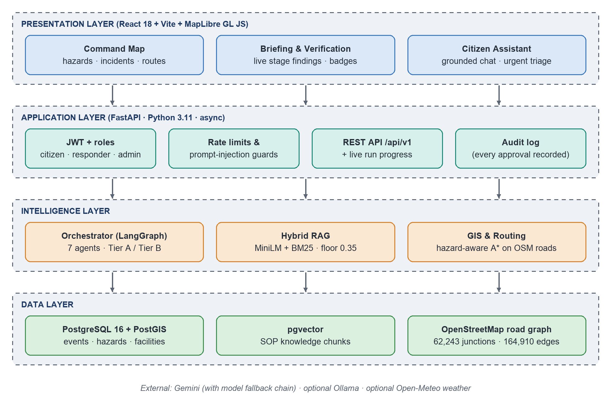
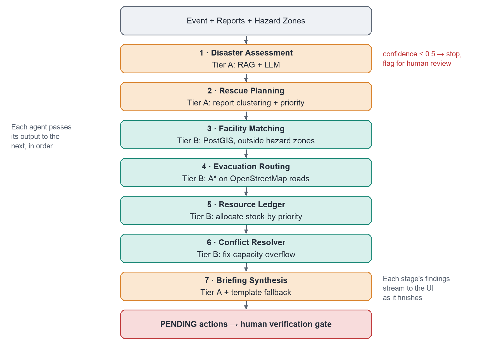
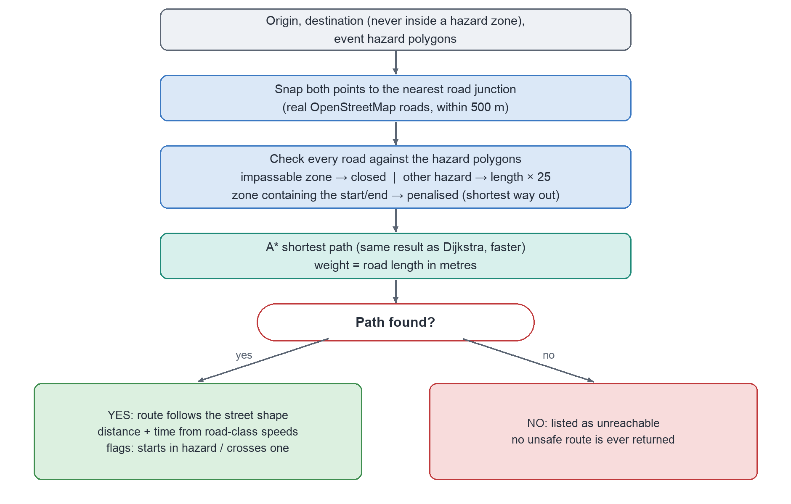

# IDRA: Intelligent Disaster Response Assistant

**Multi-agent decision support for urban disaster response in Chennai.** IDRA turns scattered incident reports, hazard maps and facility data into a prioritised, verifiable action plan: what is happening, where to rescue first, which safe hospitals and shelters to use, evacuation routes on real roads that avoid hazard zones, and how to allocate boats, ambulances and supplies. A human approves every action before it counts.

> **AI interprets, code calculates, humans decide.**


> **Research prototype.** Not for live dispatch. In an emergency in India call **112** (national), **108** (ambulance), **1070** (Tamil Nadu control room) or **1913** (Greater Chennai Corporation).

---

## Contents

- [Why IDRA](#why-idra)
- [Features](#features)
- [Architecture](#architecture)
- [How a run works](#how-a-run-works)
- [Quick start](#quick-start)
- [Configuration](#configuration)
- [Project structure](#project-structure)
- [Evaluation](#evaluation)
- [Data and provenance](#data-and-provenance)
- [Documentation](#documentation)
- [Limitations and future work](#limitations-and-future-work)
- [Authors](#authors)

---

## Why IDRA

In a flood, control rooms receive far more reports than they can read, and decisions have to be made in minutes. Existing tools each solve one piece: map dashboards show hazards but don't reason, chatbots read text but can't be trusted with numbers, and routing APIs don't understand hazard polygons.

IDRA combines these with one rule: **the language model is only used where interpretation is needed.** Anything with an exact answer (which open hospital outside the flood has free beds, which road is passable, how many boats are left) is computed by deterministic code, and every recommendation waits for a human decision.

## Features

- **Seven-agent pipeline** (LangGraph): situation assessment, rescue-zone planning, facility matching, evacuation routing, resource allocation, conflict resolution and briefing synthesis.
- **Two reliability tiers.** Tier A agents use the LLM with retrieval grounding and a rule-based fallback; Tier B agents (facilities, routing, resources) never call the LLM, so they keep working if the model is down.
- **Grounded retrieval (RAG)** over NDMA, TNSDMA and Sphere guidance: 70% semantic (MiniLM, 384-d, pgvector HNSW) + 30% lexical (BM25). Below a score of 0.35 the system **refuses**, with zero LLM calls, instead of guessing.
- **Hazard-aware routing on real roads.** A* over Chennai's OpenStreetMap network (62,243 junctions). Impassable zones close roads; other hazard zones cost 25× their length; a rescue that starts inside a hazard takes the shortest way out. Shelters and hospitals inside hazard zones are never chosen.
- **Validated AI output.** Facility names are checked against the database, priorities and numbers come from deterministic code, estimates are capped against the reports, and provenance (AI-generated vs deterministic) is set by code.
- **Human-in-the-loop gate.** Every recommendation starts `PENDING`; only an admin can approve, override or reject (override/reject need a reason), and every decision is audit-logged.
- **Citizen assistant.** Grounded safety answers with citations and nearby facilities; life-threatening messages are escalated automatically into incident reports that feed the next run.
- **Live command centre.** MapLibre map with hazards, incidents, facilities and evacuation routes; each pipeline stage shows what it found as soon as it finishes.
- **Resilient LLM client.** Gemini with a chain of fallback models and per-attempt timeouts; a fully offline mode (`LLM_BACKEND=fake`) for development and tests.

## Architecture



| Layer | Technology | Responsibility |
|---|---|---|
| Presentation | React 18, Vite, MapLibre GL, TanStack Query | Command map, run timeline, briefing and verification, citizen chat |
| Application | FastAPI (async), Pydantic | JWT auth and roles, rate limits, validation, REST API, audit log |
| Intelligence | LangGraph, sentence-transformers, NetworkX, shapely | Agent orchestration, hybrid RAG, hazard-aware routing |
| Data | PostgreSQL 16, PostGIS 3.4, pgvector | Events, reports, hazards, facilities, resources, runs, SOP embeddings, road network |
| LLM | Google Gemini (optional Ollama) | Interpretation and prose only, always with a fallback |

Everything runs in Docker Compose (`db`, `api`, `web`). The browser only talks to the API.

## How a run works



1. **Disaster Assessment** (Tier A) reads reports and hazards, retrieves SOP passages and produces severity, affected population and confidence. Below 0.5 confidence the run stops for human review.
2. **Rescue Planning** (Tier A) clusters nearby reports into rescue zones (DBSCAN, 500 m) and ranks them, marking zones cut off by impassable hazards.
3. **Facility Matching** (Tier B) finds the nearest operational hospitals and shelters with free capacity, outside every hazard zone (PostGIS).
4. **Evacuation Routing** (Tier B) computes routes on the OSM road graph (below).
5. **Resource Ledger** (Tier B) allocates depot stock to zones by priority and reports shortfalls; nothing is committed until approved.
6. **Conflict Resolver** (Tier B) fixes contradictions such as two zones overfilling one shelter.
7. **Briefing Synthesis** (Tier A) writes the prioritised briefing; the code validates it and falls back to a deterministic template if needed.

Results stream to the UI stage by stage, then wait at the verification gate.



## Quick start

**Prerequisites:** Docker Desktop, Python 3.11+, Node 20 (only if running the web app outside Docker).

```bash
git clone https://github.com/krxsh007/idra.git
cd idra
cp .env.example .env

# Python environment for migrations, seeding, tests and evaluation
python3 -m venv .venv
.venv/bin/pip install -r api/requirements.txt -r api/requirements-dev.txt

make up        # start db, api and web containers
make migrate   # create the schema
make seed      # users, facilities, resources, 3 scenarios, knowledge base, road network
```

Open **http://localhost:5173** (web app) and **http://localhost:8000/docs** (interactive API docs). Sign in with the **Admin** quick-fill button, pick *Scenario 1: Chennai Adyar & Kotturpuram Monsoon Flood* and click **Trigger Run**.

| Role | Email | Password |
|---|---|---|
| Admin | `admin@example.com` | `SEED_ADMIN_PASSWORD` in `.env` |
| Responder | `responder1@example.com` | `responder_password_1` |

### Common commands

```bash
make help    # list all commands
make test    # 150+ tests, fully offline
make eval    # evaluation harness -> docs/evaluation.md
make lint    # ruff
make mypy    # type check
make smoke   # smoke-test the running stack
```

## Configuration

All settings live in `.env` (see `.env.example`).

| Setting | Default | Notes |
|---|---|---|
| `LLM_BACKEND` | `fake` | `fake` (offline, deterministic), `gemini` or `ollama` |
| `GEMINI_API_KEY` | empty | Free key from [Google AI Studio](https://aistudio.google.com) |
| `GEMINI_MODEL` / `GEMINI_FALLBACK_MODEL` | `gemini-3.1-flash-lite` / comma-separated chain | Fallback models are tried in order on overload (503) or quota (429) errors |
| `LLM_ATTEMPT_TIMEOUT_S` | `12` | Per-model attempt; a hung request moves to the next model |
| `RAG_SCORE_FLOOR` | `0.35` | Retrieval refusal threshold |
| `AGENT_TIMEOUT_*_S`, `RUN_TOTAL_TIMEOUT_S` | see file | Per-agent and whole-run time budgets |

**Switching to Gemini:** set `LLM_BACKEND=gemini` and `GEMINI_API_KEY`, then run `make seed` again (the knowledge base is re-embedded with the real MiniLM model; offline mode uses hashed vectors) and `docker compose up -d --force-recreate api`.

## Project structure

```
idra/
├── api/                      FastAPI backend
│   ├── app/
│   │   ├── agents/           7 agents (assessment, planning, facilities, routing, resources, citizen)
│   │   ├── orchestration/    LangGraph pipeline, conflict resolver, synthesis, engine
│   │   ├── rag/              parsing, chunking, embeddings, hybrid retriever
│   │   ├── gis/              road graph, A* hazard router, snapping, clustering
│   │   ├── llm/              Gemini / Ollama / fake clients, prompts, guardrails
│   │   ├── routers/          REST endpoints
│   │   ├── db/               SQLAlchemy models and session
│   │   ├── schemas/          Pydantic request/response models
│   │   └── eval/             evaluation suites and datasets
│   └── alembic/              database migrations
├── web/                      React + Vite + MapLibre command centre
├── db/                       PostgreSQL + PostGIS + pgvector image
├── scripts/
│   ├── seed/                 seed users, facilities, resources, scenarios, knowledge base, roads
│   ├── eval/                 run the evaluation harness, generate datasets
│   └── smoke.sh              smoke test for a running stack
├── data/
│   ├── kb/raw/               knowledge-base documents (SOP summaries)
│   └── osm/                  OpenStreetMap road extract (gzipped)
├── artifacts/                road-graph manifest, evaluation results
├── tests/                    unit, integration and end-to-end tests
├── docs/                     architecture, agents, RAG, GIS, API, evaluation, ADRs, demo script
├── docker-compose.yml
└── Makefile
```

## Evaluation

`make eval` runs 34 automated metrics across retrieval, agents, routing and the full system, and writes [`docs/evaluation.md`](docs/evaluation.md). All agent and system checks use the offline model so results are reproducible; they test the system's logic and guardrails, not the quality of live Gemini text.

| Area | What is measured | Result |
|---|---|---|
| Retrieval | 40 labelled safety queries against the real knowledge base | Recall@8 0.99, MRR 0.99, Precision@5 0.77 |
| Refusal | Out-of-scope questions answered with zero LLM calls | 100% |
| Routing | 15 detour/enclosure cases on the OSM graph | 100% hazard avoidance, median 39 ms |
| Resources / conflicts | Real agents on hand-built cases | No over-allocation; 100% conflict resolution |
| Citizen escalation | 15 urgent + 15 non-urgent messages | 100% recall, 0% false positives |
| Whole system | 3 scenarios end to end, and with the LLM disabled | 100% completion; deterministic tier survives |

## Data and provenance

| Data | Source | Status |
|---|---|---|
| Road network | OpenStreetMap via Overpass (© OpenStreetMap contributors, ODbL) | Real |
| Hospital and shelter locations | Hand-curated, Chennai | Real locations, **simulated capacities** |
| Resources (boats, ambulances, kits) | Seed script | Simulated |
| Scenarios (reports, hazard polygons) | Seed script, real Chennai places | Synthetic |
| Knowledge base | Condensed summaries based on NDMA, TNSDMA and Sphere guidance | Prototype summaries, not the official documents |
| Embedding model | `sentence-transformers/all-MiniLM-L6-v2` | Pretrained, used as is |

Every record carries a provenance label (`REAL`, `SIMULATED`, `SYNTHETIC`) that is shown in the UI.

## Documentation

- [Architecture](docs/architecture.md) · [Agents](docs/agents.md) · [RAG](docs/rag.md) · [GIS and routing](docs/gis.md) · [API](docs/api.md)
- [Evaluation report](docs/evaluation.md) · [Demo script](docs/demo_script.md)
- [Architecture decision records](docs/decisions/)

## Limitations and future work

- Capacities and resources are simulated; the knowledge base is small and summarised.
- Evaluation is offline; live LLM output quality and a usability study with responders have not been measured yet.
- One study area (central Chennai) with an in-memory road graph.

Next steps: live feeds for hospital beds, river levels and closures; a calibrated, evidence-based confidence score; ingesting the official guideline PDFs; pgRouting for city- or state-wide routing; and a field evaluation against a past event such as the 2015 Chennai floods.

## Authors

**Krish Manoj Mehta** and **Abhijay Singh Panwar**, School of Computer Science Engineering and Information Systems, VIT Vellore (BITE497J, Project I).
Guide: **Dr. Angulakshmi M**, Associate Professor.
